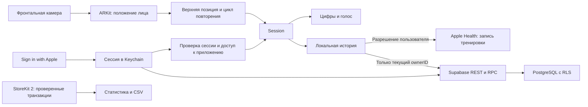

# Архитектура pushx

pushx — нативное приложение для iPhone и iPad с iOS / iPadOS 17+. Интерфейс построен на SwiftUI, отслеживание лица работает через ARKit на устройстве. Серверная часть — Supabase Auth, PostgreSQL и Edge Function. При первом запуске обязателен вход с Apple. Развёртывание сервера и реальные интеграции требуют конфигурации владельца приложения; без работающего Apple/Supabase входа Release не открывает основной интерфейс.

## Состав

| Каталог / компонент | Ответственность |
| --- | --- |
| `iOS/Forma/App` | Запуск, конфигурация, язык и тема |
| `iOS/Forma/Views` | Тренировка, история, друзья, настройки и Plus |
| `iOS/Forma/Detection/FaceDistanceCounter.swift` | Разрешение камеры, ARSession, расстояние до лица и жизненный цикл |
| `iOS/Forma/Detection/FaceDistanceEngine.swift` | Автоматическая настройка верхней позиции и нормализация движения |
| `iOS/Forma/Detection/RepCycleEngine.swift` | Независимая от камеры машина состояний повторения |
| `iOS/Forma/Models/WorkoutStore.swift` | Локальный архив, черновик, синхронизация и CSV |
| `iOS/Forma/Services` | Apple Auth, REST API, StoreKit 2, HealthKit и озвучивание |
| `Backend/supabase` | Миграция, RLS, RPC и удаление аккаунта |
| `iOS/FormaTests`, `Backend/tests` | Алгоритм, контракты и серверные ограничения |

## Подсчёт

Устройство кладут экраном вверх под лицом. После старта пользователь задерживается в верхней позиции примерно на секунду: движок получает устойчивую базовую дистанцию. ARKit определяет положение лица относительно камеры, а приложение отслеживает приближение и возврат. Видео с камеры в интерфейсе не показывается. Ручного подсчёта и записи видео нет.

Верхняя позиция принимается после не менее 15 измерений за 0,8 секунды с разбросом до 10%. Базовая дистанция допустима от 0,25 до 1 метра; сигнал ARKit принимается от 0,08 до 1,5 метра. Эти границы — параметры алгоритма, а не обещание аппаратной точности. Два порога и короткая выдержка подавляют дрожание. Повтор засчитывается после цикла «верх → низ → верх». При краткой потере лица внизу на устройствах с TrueDepth используется свежая центральная глубина кадра. Если нижняя фаза уже подтверждена, движок допускает короткое перекрытие до 0,85 секунды, но засчитывает повтор только после устойчивого возврата наверх. Одиночное нижнее измерение не завершает нижнюю фазу. Долгая потеря лица, смена пользователя, пропуск кадров или слишком длинный цикл сбрасывают незавершённое движение. Пауза сохраняет сумму; после продолжения верхняя позиция настраивается заново.

Поддержка проверяется через `ARFaceTrackingConfiguration.isSupported`. TrueDepth используется ARKit на оснащённых им устройствах; современные версии ARKit также поддерживают устройства с Apple Neural Engine без TrueDepth. На Simulator или другом неподдерживаемом устройстве приложение честно сообщает об отсутствии автосчёта. При отказе в разрешении счётчик предлагает открыть настройки, сохраняя доступ к истории и другим разделам. Это оценка движения лица, а не проверка спортивной техники.

Core Motion контролирует неподвижность телефона: устойчивое движение временно останавливает обработку повторов, а после 0,75 секунды покоя заново определяется верхняя позиция. Сумма сохраняется. Разовый шум не переключает состояние; данные движения не записываются.

Кнопка старта на главной открывает и автоматически запускает тренировку после готовности камеры. Объяснение разрешения и положения устройства показывается только при первом использовании. Цифра закреплена в независимом центральном слое; статус сверху и подсказка снизу не меняют её положение. Таймер, пауза и завершение находятся в отдельной панели постоянной высоты.

Новые записи сохраняют `detectionMode = camera`; старые `touch` остаются совместимыми с историей, CSV и сервером. Лицо не используется для идентификации. Видео, фотографии, геометрия лица, расстояния и промежуточные измерения не сохраняются и не отправляются на сервер. Озвучивание использует системный `AVSpeechSynthesizer`, микрофон не требуется. Источники и ограничения датчиков — в [Sensors.md](Sensors.md).

## Адаптация устройств

Проект универсальный (`TARGETED_DEVICE_FAMILY = 1,2`). На iPhone разрешён только портрет, на iPad — обе портретные и обе альбомные ориентации. Запрос landscape на iPhone оставляет интерфейс портретным и сохраняет счёт текущей тренировки. Главная со счётчиком не содержит ScrollView: диаметр кольца и размещение элементов зависят от высоты окна; на компактном экране скрыта дополнительная подсказка. При Accessibility Dynamic Type приоритет отдан сегодняшнему результату и кнопке тренировки; подробная статистика доступна в истории. Ошибки и восстановленные тренировки доступны через кнопку состояния. Контейнеры остальных экранов ограничивают ширину текста; активная тренировка закрепляет счётчик в центре, а вводные экраны и итог допускают прокрутку при недостаточной высоте. Состояние тренировки живёт вне веток компоновки, поэтому поворот iPad и изменение размера окна не обнуляют результат.

Изменение геометрии окна приостанавливает тренировку; продолжение заново определяет верхнюю позицию, сохраняя результат. План и ограничения проверки iPhone Duo, включая отсутствие его профиля в текущем Xcode 27.0, — в [Compatibility.md](Compatibility.md).

## Локальные данные и владельцы

`WorkoutRecord` содержит UUID, начало, окончание, число повторений, режим, `ownerID`, признаки синхронизации с облаком и Health. Архив `workouts.json` и текущий черновик хранятся в Application Support. Запись атомарная, с защитой файла iOS до первой разблокировки после перезапуска. Каталог локальной истории исключён из резервных копий устройства; восстановление из облака доступно только для записей вошедшего аккаунта. При повторном запуске черновик с ненулевым результатом восстанавливается как завершённая локальная тренировка. Ошибка хранения выводится в интерфейсе.

`ownerID` фиксируется при старте сессии. В обычном Release пользователь уже вошёл с Apple. Поддержка `ownerID = nil` оставлена для старых локальных записей и Debug preview; повседневного гостевого режима в релизе нет. Такие записи не получают нового владельца и **никогда автоматически не загружаются в облако**. Для синхронизации выбираются только записи с UUID текущего вошедшего пользователя. Локальная копия другого аккаунта скрыта; выход из аккаунта не удаляет её. Вход в другой аккаунт не переносит ему прежние результаты.

Повторная отправка использует исходный UUID и точные даты. Сервер не создаёт копию уже принятой записи. История с сервера читается страницами по 1000 элементов и объединяется по UUID. Отказ сервера оставляет локальную запись на месте и показывает ошибку синхронизации. Детальные ограничения — в [Backend.md](Backend.md).

Даты личных графиков группируются по локальному календарю. Соревнования используют дату **UTC по окончанию тренировки**. Офлайн-загрузка допустимой давности может обновить прошлый день; граница личного и соревновательного дня может отличаться.

## Apple Health

HealthKit запрашивает только запись `HKWorkoutType`: `toShare: [workoutType]`, `read: []`. Включение добровольное и доступно бесплатно после входа. На iPad с iPadOS 17+ используется та же проверка доступности HealthKit; фактический доступ зависит от устройства и его ограничений. Приложение не читает тренировки, пульс, вес или другие медицинские записи, не использует Health для рейтинга.

Завершённая сессия записывается через `HKWorkoutBuilder` как `.traditionalStrengthTraining` с началом, окончанием и длительностью. Число повторений находится в пользовательском metadata `app.forma.pushups.repetitions`. Калории, расстояние и пульс не оцениваются. В интерфейсе «Здоровья» запись представлена силовой тренировкой; отдельного стандартного показателя количества отжиманий приложение не создаёт.

Для повторной доставки задаются `HKMetadataKeySyncIdentifier` с UUID записи и `HKMetadataKeySyncVersion = 1`. Одинаковая сессия не должна плодить копии; повтор после сбоя входит в проверку на реальном устройстве. Назначение ключей описано в [документации Apple](https://developer.apple.com/documentation/healthkit/hkmetadatakeysyncidentifier). Признак `healthSynced` — локальное подтверждение успешного сохранения, а не чтение состояния Health. Если человек позже удалит запись вручную в «Здоровье», pushx об этом не узнаёт.

Отключение синхронизации прекращает будущую запись. Удаление аккаунта pushx не удаляет ранее добавленные тренировки из Health; ими пользователь управляет в приложении «Здоровье».

## Авторизация и сервер

На первом запуске Welcome допускает к тренировкам только после появления действующей сессии Apple/Supabase. При следующих запусках восстанавливается сохранённая сессия; выход возвращает экран входа. Отсутствие сервера или его публичной конфигурации не подменяется фиктивным успехом. Существенные функции аккаунта — облачная история, друзья и дневные соревнования.

Только Debug поддерживает `UPRA_LOCAL_PREVIEW=1` для локальной проверки UI без авторизации. Проверка флага исключена из Release компиляцией. Этот режим не доказывает работоспособность авторизации и не должен использоваться в описании App Store как доступный гостевой сценарий.

`AuthenticationServices` получает Apple credential с SHA-256 случайного nonce. Исходный nonce отправляется в Supabase ID token exchange. Сессия с access/refresh token хранится в Keychain с `WhenUnlockedThisDeviceOnly`, обновление сохраняет оба новых токена. Проверяются отзыв Apple credential и смена аккаунта. Профиль содержит UUID, уникальный friend code и nullable `display_name`. На первом разрешении запрашивается `.fullName`; имя сохраняется в Keychain по Apple subject до обмена токена и импортируется только в ещё пустой серверный профиль. Обновление имени из настроек синхронизирует сервер, сессию и кеш; отсутствие имени в следующем Apple credential не затирает сохранённое. Выход сохраняет кеш имени, удаление аккаунта удаляет его. Друзьям видны имена и дневные результаты; код нужен для поиска и отправки приглашения. Фото и сообщения отсутствуют.

PostgreSQL разрешает клиенту читать только собственные записи; изменения выполняются через проверяемые RPC. Кнопка Apple использует системный `ASAuthorizationAppleIDButton`: белый стиль в тёмной теме и чёрный в светлой, обновляемый при смене темы. Высота — 44 points, пропорции текста задаёт системный компонент.

Друзья получают дневные агрегаты подтверждённых участников, а не чужую историю тренировок. Блокировка удаляет дружбу и запрещает новые заявки в обе стороны; снятие блокировки доступно отдельно. Регистрация и друзья бесплатны.

Удаление аккаунта требует свежей авторизации Apple. Edge Function проверяет действующую Supabase сессию, подпись/issuer/audience/срок Apple ID token и совпадение subject с доверенной identity. После обмена кода проверяется и возвращённый Apple token, затем отзывается разрешение Apple и удаляется Auth пользователь с каскадом данных. Серверные секреты остаются только на сервере. Полный контракт и поведение при сбоях — [Backend.md](Backend.md).

## Бесплатная версия и Plus

Бесплатны автосчёт, голос, обычная история и недельный график, Apple Health, темы, языки, вход и соревнования. Plus открывает средний размер подхода, количество активных дней, суммарное время и CSV видимой истории. Данные остаются доступными и после окончания Plus.

StoreKit 2 загружает `forma.plus.monthly` и `forma.plus.yearly`. Доступ даётся по проверенным Apple транзакциям, учитываются окончание, отзыв, upgrade и проверенный grace period. Обработчик слушает обновления транзакций; восстановление запускает `AppStore.sync()`. Подписка привязана к Apple аккаунту магазина; право StoreKit не определяется аккаунтом Supabase. Основной интерфейс приложения при этом требует входа с Apple, как и остальные функции. На сервер не передаётся заявленный клиентом флаг Plus, платных серверных API в этой версии нет.

Локальный `Forma.storekit` предназначен для разработки. App Store Connect, Sandbox и реальные покупки настраиваются отдельно. Покупка в интерфейсе отключена, пока отсутствует корректный HTTPS `PRIVACY_URL`; публичный адрес политики — обязательная часть подготовки релиза.

## Конфигурация и границы

Публичные `SUPABASE_URL`, `SUPABASE_ANON_KEY`, `PRIVACY_URL`, `TERMS_URL` читаются из Info.plist. По умолчанию серверные URL/key и privacy URL пусты; terms указывает на стандартную Apple EULA. Пустая серверная конфигурация блокирует прохождение обязательного входа в Release и является незавершённой задачей перед публикацией. В приложение нельзя добавлять `.p8`, service role key и Apple client secret.

Название приложения — `pushx`, строчными. Знак монохромный — белая волна на тёмном фоне, чёрная на светлом. Это одна плавная траектория повторения, исходник в `Design/pushx-mark.svg`; `PushMark` и AppIcon используют ту же геометрию. Дизайн использует Geologica, монохромную основу и настраиваемый акцент с фиолетовым вариантом. Для китайских символов применяется доступный системный шрифт. Темы: системная, светлая, тёмная. Локализации: `ru`, `en`, `zh-Hans` и системный выбор. UI-китайский — упрощённый; он не означает автоматическую готовность распространения и сетевой доступности во всех регионах Китая.

Алгоритм не является проверкой спортивной техники или защитой от подмены результатов. Качество подсчёта зависит от положения устройства, света и видимости лица. Сборка и симулятор подтверждают работоспособность кода и интерфейса; точность камеры, Apple Health, Apple Auth и покупки требуют отдельных проверок на физических устройствах. Их план — [Testing.md](Testing.md).
