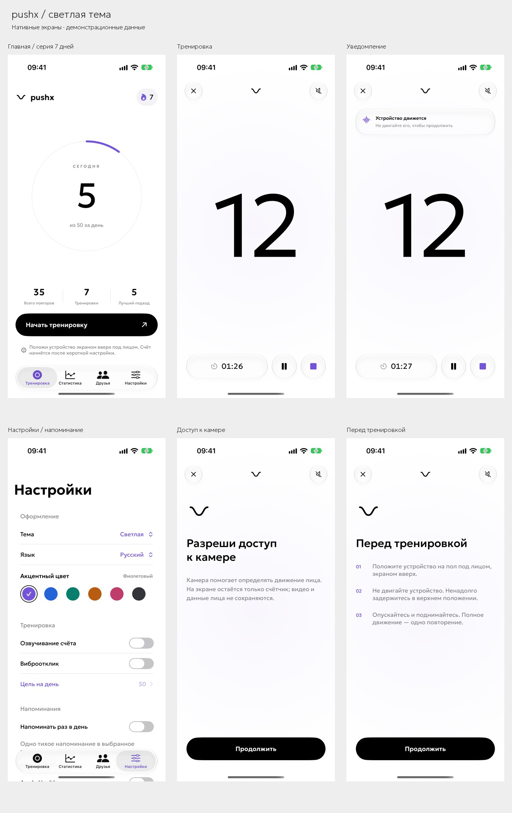
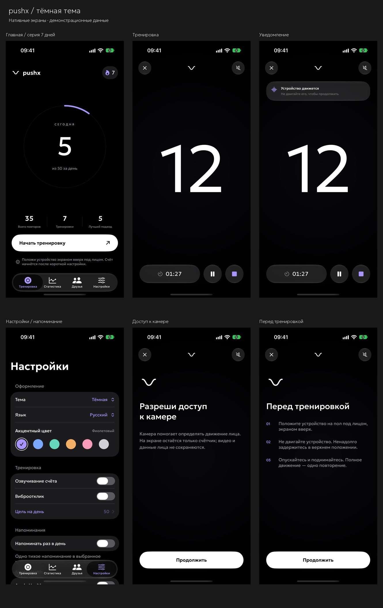

# интерфейс pushx

22 октября 2026 года. нативные снимки iPhone 17 pro: Geologica light, монохромная волна, настраиваемый акцент. на главной нет прокрутки. нажатие на серию открывает календарь в статистике; день продолжается от 5 отжиманий. напоминание выключено по умолчанию и включается добровольно с выбором времени.

| светлая тема | тёмная тема |
| --- | --- |
|  |  |

[календарь серии](final-stats-themes.jpg) · [тренировка](final-workout-themes.jpg) · [главная](final-home-themes.jpg) · [настройки](final-settings-themes.jpg)

в счётчике нет надписи над цифрой и постоянных подсказок. одно округлое уведомление Liquid Glass появляется сверху после задержки, не сдвигая число. вводные экраны используют короткий текст и знак pushx, закреплённый в одной позиции. после первого разрешения и инструкции тренировка запускается сразу.

снимки сделаны в изолированной тестовой сборке с настоящей SwiftUI-компоновкой. для главной и статистики использованы демонстрационные семь дней по пять повторений; число 12 на экране тренировки также демонстрационное. в production нет имитации датчиков и вымышленных друзей. эти изображения показывают интерфейс, не измеряют точность камеры и не подтверждают живые Apple Auth, health или покупки. шрифт распространяется по [SIL Open Font License 1.1](../../iOS/Forma/Resources/Fonts/Geologica-OFL.txt).

## предыдущие проверки — 21 октября

[обзор светлой темы](pushx-light.jpg) · [обзор тёмной темы](pushx-dark.jpg) · [акцент меню](settings-accent-blue.png) · [блок входа Apple](settings-account-card.png). это снимки до последних изменений тренировки, серии и напоминаний. язык дополнительно проверен без перезапуска приложения.

## архив — 19 октября 2026

ранний вариант с Onest сохранён для истории разработки. его оформление и горизонтальная ориентация iPhone больше не отражают актуальный интерфейс pushx.

| iPhone — прежний вариант | iPad — прежний вариант |
| --- | --- |
| [главная](iphone-17-pro-adaptive-home-portrait.png) | [iPad pro — главная](ipad-pro-11-adaptive-home-portrait.png) |
| [настройки](iphone-17-pro-settings-light.png) | [iPad pro — тренировка горизонтально](ipad-pro-11-adaptive-workout-landscape.png) |
| [цель на день](iphone-17-pro-goal-dark.png) | [iPad mini — главная](ipad-mini-adaptive-home-portrait.png) |
| [вход Apple](iphone-17-pro-sign-in-dark.png) | |
| [тренировка горизонтально](iphone-17-pro-adaptive-workout-landscape.png) | |
| [увеличенный текст](iphone-17-pro-largest-text-workout.png) | |

в архивных кадрах тренировки использован режим касаний.
